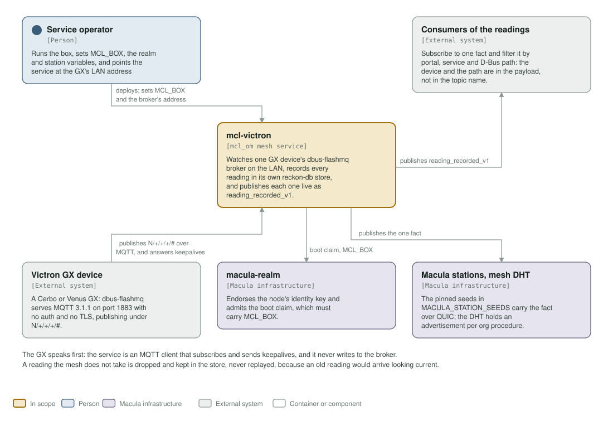
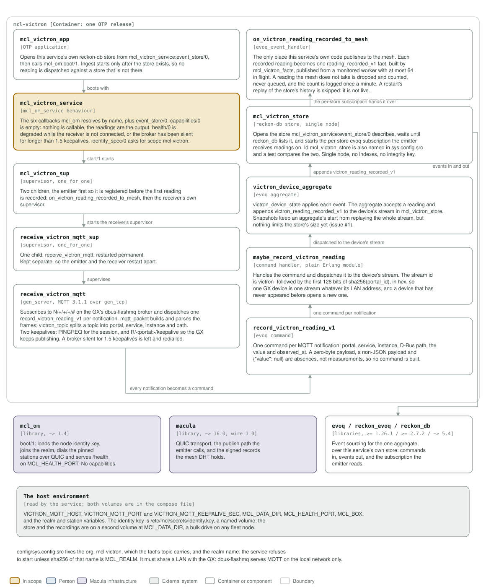

# mcl-victron architecture: C4 model

*This exists so a reader can see what mcl-victron talks to, and what it is made
of, without reading it.*

**Status: one fact, no procedures of its own.** The service subscribes to a Victron GX
device's dbus-flashmq MQTT broker on the LAN, records every reading in its own
reckon-db store, and publishes each one live on the mesh. `capabilities/0` is
empty: nothing is callable, the readings are the output.

## Level 1: system context

| Element | Kind | Role |
| --- | --- | --- |
| mcl-victron | In scope | An MQTT client on the GX's broker and a publisher on the mesh, in one OTP release in one container. Answers `/health` on 8483 and offers no procedure of its own |
| Service operator | Person | Runs the box, sets `MCL_BOX`, the realm and station variables, and points the service at the GX's LAN address |
| Consumers of the readings | External system | Subscribe to `reading_recorded_v1` and filter it by portal, service and D-Bus path; the device and the path are in the payload, never in the topic name |
| Victron GX device | External system | A Cerbo or Venus GX. Its dbus-flashmq broker serves MQTT 3.1.1 on port 1883 with no auth and no TLS, publishing under `N/+/+/+/#` |
| macula-realm | Macula infrastructure | Endorses the node's identity key and admits the boot claim, which must carry `MCL_BOX` |
| Macula stations, mesh DHT | Macula infrastructure | The pinned seeds in `MACULA_STATION_SEEDS` carry the fact over QUIC; the DHT holds the node's advertisement |

The GX speaks first: this service is an MQTT client that subscribes and sends
keepalives, and it never writes to the broker.

## Level 2: containers and components

| Component | Technology | Responsibility |
| --- | --- | --- |
| `mcl_victron_app` | OTP application | Opens the store from `mcl_victron_service:event_store/0`, then `mcl_om:boot/1`. Ingest starts only after the store exists |
| `mcl_victron_service` | the `mcl_om_service` behaviour | The six callbacks plus `event_store/0`. `capabilities/0` is empty; `health/0` is `degraded` while the receiver is not connected or the broker has been silent for 1.5 keepalives; `identity_spec/0` asks for scope `mcl-victron` |
| `mcl_victron_sup` | supervisor, `one_for_one` | Two children, the emitter first so it is registered before the first reading is recorded |
| `receive_victron_mqtt_sup` | supervisor, `one_for_one` | One permanent child, kept separate so the emitter and the receiver restart apart |
| `receive_victron_mqtt` | `gen_server`, MQTT 3.1.1 over `gen_tcp` | Subscribes to `N/+/+/+/#` and dispatches one command per notification; `mqtt_packet` builds and parses the frames and `victron_topic` splits a topic into portal, service, instance and path. Sends both keepalives and redials a broker silent for 1.5 of them |
| `record_victron_reading_v1` | evoq command | The reading as it arrived. A zero-byte payload, a non-JSON payload and `{"value": null}` are absences, so no command is built |
| `maybe_record_victron_reading` | `evoq_command_handler` | Dispatches the command to the device's stream, whose id is `victron-` plus the first 128 bits of `sha256(portal_id)` |
| `victron_device_aggregate` | evoq aggregate | `victron_device_state` applies each event; the aggregate appends `victron_reading_recorded_v1` to the device's stream. Snapshots avoid a full replay, but nothing limits the store's size yet (issue #1) |
| `mcl_victron_store` | reckon-db store, single node | Opens the store, waits until `reckon_db` lists it, and starts the per-store evoq subscription the emitter receives readings on. Id `mcl_victron_store` is also named in `sys.config.src`, and a test compares the two |
| `on_victron_reading_recorded_to_mesh` | `evoq_event_handler` | The only place this service touches the mesh: one `reading_recorded_v1` fact per reading, built by `mcl_victron_facts`, published from a monitored worker with at most 64 in flight. A reading the mesh does not take is dropped and counted |
| `mcl_om` | library, `~> 1.4` | `boot/1`: loads the node identity key, joins the realm, dials the pinned stations over QUIC and serves `/health` on `MCL_HEALTH_PORT` |
| macula | library, `~> 16.0`, wire 1.0 | QUIC transport, the publish path the emitter calls, and the signed records the mesh DHT holds |
| `evoq` / `reckon_evoq` / `reckon_db` | libraries, `>= 1.26.1` / `>= 2.7.2` / `~> 5.4` | Event sourcing for the one aggregate, over this service's own store |
| The host environment | environment and volumes | `VICTRON_MQTT_HOST`, `VICTRON_MQTT_PORT`, `VICTRON_MQTT_KEEPALIVE_SEC`, `MCL_DATA_DIR`, `MCL_HEALTH_PORT`, `MCL_BOX`, and the realm and station variables. The identity key is a named volume at `/etc/mcl/secrets`; the store is a second volume at `MCL_DATA_DIR` |

**Where the station list comes from.** It is not in `config/sys.config.src`: `mcl_om` reads `MACULA_STATION_SEEDS` and `MACULA_STATION_NODE_IDS` from the environment at boot, paired index for index, so this repository pins no station and the list may be any length.

`config/sys.config.src` fixes the org, `mcl-victron`, which the fact's topic
carries, and the realm name; the service refuses to start unless
`sha256(MCL_REALM_NAME)` is `MCL_REALM`. It must share a LAN with the GX:
dbus-flashmq serves MQTT on the local network only.

A reading the mesh does not take is dropped and kept in the store, never
replayed, because an old reading would arrive looking current. A restart's
replay of the store's history is skipped for the same reason
(`replay_policy/0`).

## Drawing them

`assets/c4-context.svg` and `assets/c4-components.svg` are generated by
`architecture/c4_diagrams.py` (`python3 architecture/c4_diagrams.py`), from the
code and never from this page: the callbacks in `mcl_victron_service.erl`, the
receiver and its supervisor, the command desk and the aggregate, the emitter in
`on_victron_reading_recorded_to_mesh.erl`, the dependencies in `rebar.config`,
the port and volumes in the `Containerfile` and `deploy/docker-compose.yml`.
When one of those changes, the diagram changes in the same commit.

Two rules for the files themselves, so they render everywhere they are read
(GitHub, an IDE, `rsvg-convert`): self-contained SVG, and literal colours in plain
classes plus a `prefers-color-scheme` dark block, never CSS custom properties,
which `rsvg-convert` renders black.

The check that keeps them here is the `c4-model` job in
`.github/workflows/c4-model.yml`. It is red until both files exist and are
shown, and it stays red if either one goes missing.
